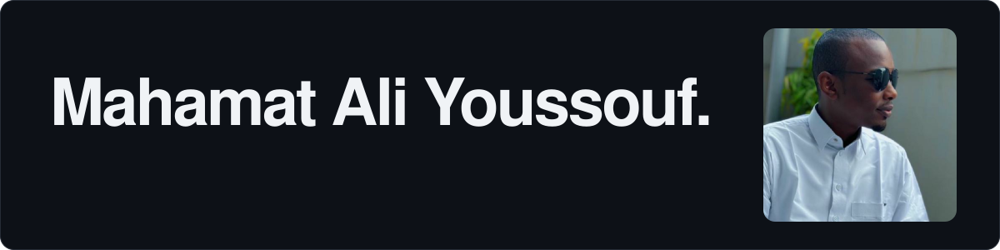
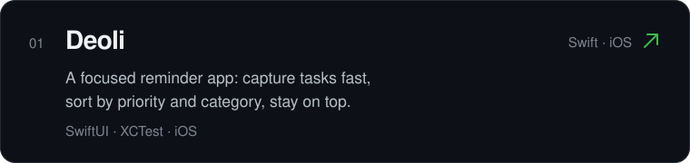
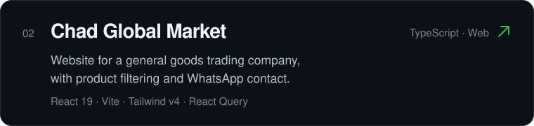
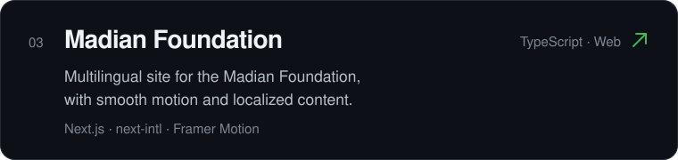
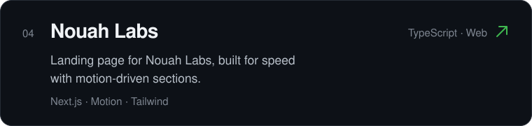
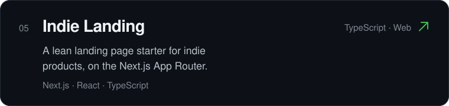
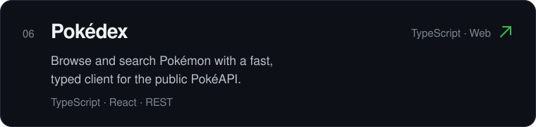

  

  I build web and iOS products end to end: fast sites and web apps with <b>Next.js</b> and <b>React</b>, 
  and native iOS apps with <b>SwiftUI</b>. I care about clean interfaces and motion that feels right.

<h3>Featured projects</h3>

<h3>Toolbox</h3>

  

